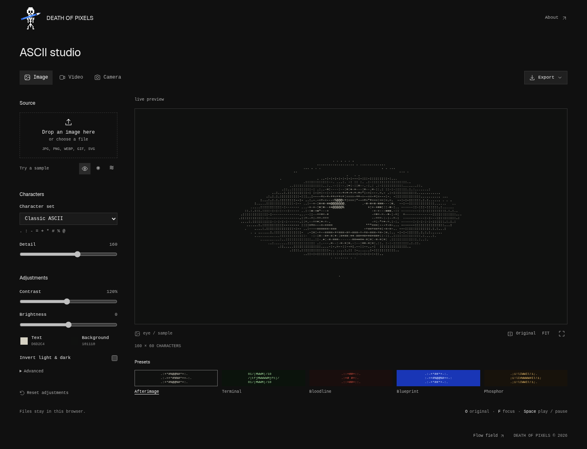
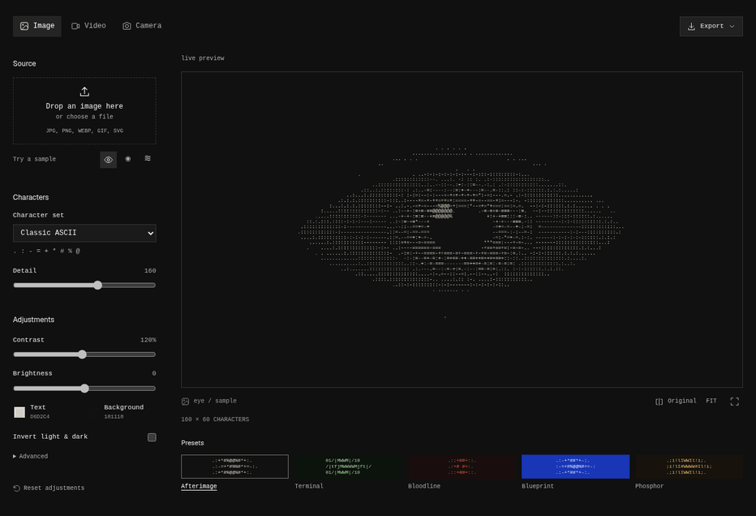
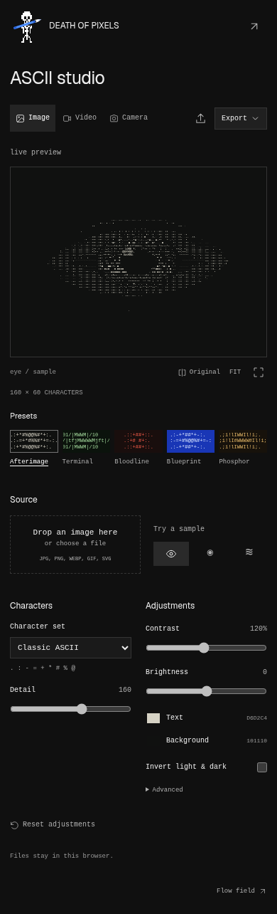
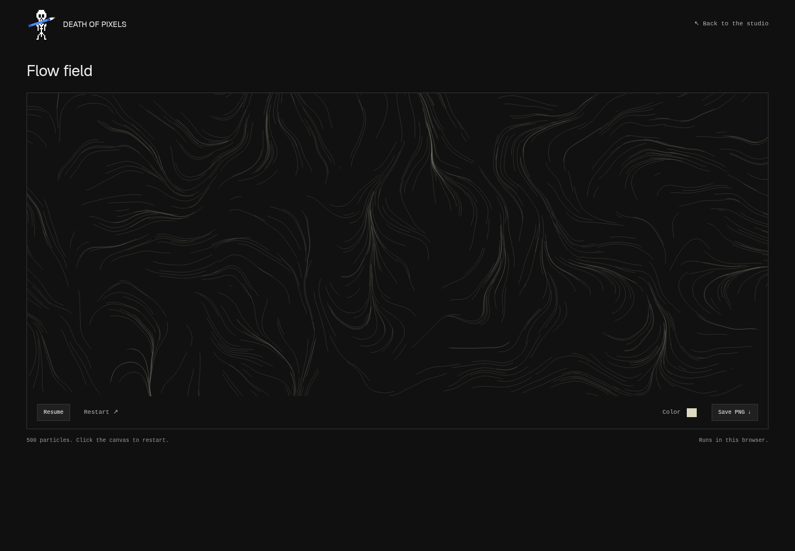

# Death of Pixels

To make ASCII art with a few clear controls and keep the source files on your device.

Start with an image, a video, or your camera. Adjust the characters, light, and color. Save the result. Everything runs in your browser.



## Run

```sh
python -m http.server 4173 --bind 127.0.0.1
```

Open [localhost:4173](http://localhost:4173).

You can also open `index.html` directly for images and video. The camera needs localhost or HTTPS.

## Use

1. Drop in a file, start the camera, or choose a sample.
2. Pick a preset or adjust detail, contrast, brightness, and colors. Use **Original** to compare.
3. Export a PNG, copy or download the text, or record a silent WebM. Save settings to use them again.

The demo below shows preset changes, detail adjustment, comparison, and PNG export.



[Watch the MP4](docs/media/demo.mp4)

**Shortcuts:** `O` original · `F` expand · `Esc` close · `Space` play or pause.

<details>
<summary>Mobile view</summary>

<br>


</details>

## Flow field

A separate [particle sketch](vector_path.html). Pause it, change the color, or save a frame. Click the canvas to restart.



## Notes

- Images: up to **40 MB**. Video: up to **500 MB**. Recordings: up to **five minutes**.
- GIFs render as still images. Video formats and recording depend on browser support.
- HTML, CSS, JavaScript, and p5.js. Dependencies are included locally.

Run the conversion tests with Node:

```sh
node tests/ascii-engine.test.cjs
```

The optional [browser checks](tests/browser-smoke.cjs) use Playwright. With the local server running:

```sh
PLAYWRIGHT_MODULE=/path/to/playwright-core \
BROWSER_PATH=/path/to/chromium \
node tests/browser-smoke.cjs
```

## License

[CC BY-NC 4.0](LICENSE.md). Credit the project. Noncommercial use.
p5.js and Geist retain their licenses in [vendor](vendor/) and [assets/fonts](assets/fonts/).
